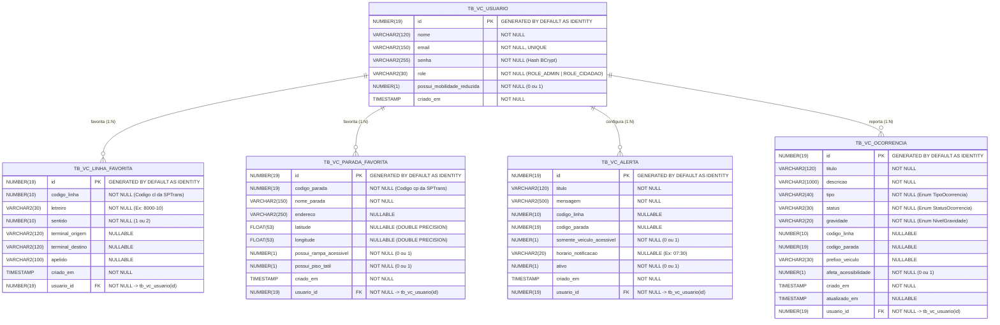

# Guia Técnico para o Banco de Dados (Instruções para o Kenji)

Olá, **Kenji**! 👋  
Este documento foi preparado pela equipe de **Java Advanced (`gs-java-api`)** para alinhar **100% do contrato entre o Backend Java/Spring Boot e o Banco de Dados Oracle + PL/SQL (`gs-database`)**, garantindo a **Separação de Responsabilidades**:
- **Nós (Java):** Já deixamos toda a API REST, Entidades JPA, DTOs, Repositories, JPQL, Specifications e o `application-oracle.yml` prontos esperando o banco.
- **Você (Kenji - Banco de Dados):** Cuida da modelagem relacional no Oracle, criação das tabelas (`DDL`), carga de dados (`DML` com no mínimo 10 registros por tabela) e dos scripts `PL/SQL` exigidos pela disciplina **Mastering Relational and Non-Relational Database**.

> [!IMPORTANT]
> **Por que precisamos seguir exatamente os nomes de tabelas e colunas abaixo?**  
> Na API Java, o perfil Oracle está configurado com `spring.jpa.hibernate.ddl-auto=validate`. Isso significa que o Java **não vai recriar nem apagar suas tabelas**; ao subir, o Hibernate vai **validar** se as tabelas e colunas que você criou no Oracle batem exatamente com as classes `@Entity` do Java!

---

## 1. Diagrama Entidade-Relacionamento (MER / DER)

A solução **ViaCidadã (CitizenTech)** possui **5 tabelas relacionais** (a GS pede no mínimo 4 tabelas relacionadas, então já superamos a meta com folga!). Todas as 4 tabelas operacionais possuem relacionamento **N:1 (`ManyToOne`)** com a tabela central de Usuários (`tb_vc_usuario`).



---

## 2. Especificação Detalhada das 5 Tabelas (Mapeamento Java `@Entity` -> Oracle SQL)

> [!TIP]
> **Atenção aos tipos no Oracle para passar no `ddl-auto: validate` do Hibernate 6:**
> - **`Long` (Java)** $\rightarrow$ `NUMBER(19)` no Oracle.
> - **`Integer` (Java)** $\rightarrow$ `NUMBER(10)` no Oracle.
> - **`Boolean` (Java)** $\rightarrow$ `NUMBER(1,0)` no Oracle com `CHECK (coluna IN (0, 1))`.
> - **`Double` (Java)** $\rightarrow$ `FLOAT(53)` ou `DOUBLE PRECISION` no Oracle (o Hibernate 6 espera float binário/double precision quando o atributo Java é `Double` sem `@Column(precision/scale)`).
> - **`LocalDateTime` (Java)** $\rightarrow$ `TIMESTAMP(6)` no Oracle.
> - **`@Id @GeneratedValue(strategy = GenerationType.IDENTITY)`** $\rightarrow$ No Oracle 12c+/19c (usado na FIAP), usar `NUMBER(19) GENERATED BY DEFAULT AS IDENTITY PRIMARY KEY`.

---

### Tabela 1: `tb_vc_usuario` (Entidade `Usuario.java`)
Armazena os cidadãos e administradores da plataforma.

| Coluna no Oracle | Tipo Oracle Exato | Obrigatório? | Regra / Restrição (`CHECK` / `UNIQUE`) |
|---|---|---|---|
| `id` | `NUMBER(19) GENERATED BY DEFAULT AS IDENTITY` | `NOT NULL` | `PRIMARY KEY (pk_vc_usuario)` |
| `nome` | `VARCHAR2(120)` | `NOT NULL` | Nome completo do usuário |
| `email` | `VARCHAR2(150)` | `NOT NULL` | `UNIQUE (uk_vc_usuario_email)` |
| `senha` | `VARCHAR2(255)` | `NOT NULL` | Senha criptografada (BCrypt) |
| `role` | `VARCHAR2(30)` | `NOT NULL` | `CHECK (role IN ('ROLE_ADMIN', 'ROLE_CIDADAO'))` |
| `possui_mobilidade_reduzida` | `NUMBER(1,0)` | `NOT NULL` | `DEFAULT 0 CHECK (possui_mobilidade_reduzida IN (0, 1))` |
| `criado_em` | `TIMESTAMP(6)` | `NOT NULL` | `DEFAULT CURRENT_TIMESTAMP` |

---

### Tabela 2: `tb_vc_linha_favorita` (Entidade `LinhaFavorita.java`)
Armazena as linhas da SPTrans favoritadas por cada cidadão.
- **Regra de Negócio no Java (`LinhaFavoritaService`):** Um mesmo usuário não pode favoritar o mesmo `codigo_linha` duas vezes (sugestão de constraint única composta: `UNIQUE (usuario_id, codigo_linha)`).

| Coluna no Oracle | Tipo Oracle Exato | Obrigatório? | Regra / Restrição (`FK` / `CHECK`) |
|---|---|---|---|
| `id` | `NUMBER(19) GENERATED BY DEFAULT AS IDENTITY` | `NOT NULL` | `PRIMARY KEY (pk_vc_linha_favorita)` |
| `codigo_linha` | `NUMBER(10)` | `NOT NULL` | Código interno da linha na SPTrans (`cl`, ex: `2506`) |
| `letreiro` | `VARCHAR2(30)` | `NOT NULL` | Letreiro da linha (ex: `'8000-10'`) |
| `sentido` | `NUMBER(10)` | `NOT NULL` | `CHECK (sentido IN (1, 2))` |
| `terminal_origem` | `VARCHAR2(120)` | `NULL` | Nome do terminal de origem |
| `terminal_destino` | `VARCHAR2(120)` | `NULL` | Nome do terminal de destino |
| `apelido` | `VARCHAR2(100)` | `NULL` | Apelido dado pelo usuário (ex: `'Trabalho - Centro'`) |
| `criado_em` | `TIMESTAMP(6)` | `NOT NULL` | `DEFAULT CURRENT_TIMESTAMP` |
| `usuario_id` | `NUMBER(19)` | `NOT NULL` | `FOREIGN KEY REFERENCES tb_vc_usuario(id) ON DELETE CASCADE` |

---

### Tabela 3: `tb_vc_parada_favorita` (Entidade `ParadaFavorita.java`)
Armazena os pontos de parada favoritados pelo usuário e seus indicadores de acessibilidade na calçada.

| Coluna no Oracle | Tipo Oracle Exato | Obrigatório? | Regra / Restrição (`FK` / `CHECK`) |
|---|---|---|---|
| `id` | `NUMBER(19) GENERATED BY DEFAULT AS IDENTITY` | `NOT NULL` | `PRIMARY KEY (pk_vc_parada_favorita)` |
| `codigo_parada` | `NUMBER(19)` | `NOT NULL` | Código da parada na SPTrans (`cp`, ex: `340015329`) |
| `nome_parada` | `VARCHAR2(150)` | `NOT NULL` | Nome da parada (ex: `'PARADA PAULISTA B/C'`) |
| `endereco` | `VARCHAR2(250)` | `NULL` | Endereço de referência |
| `latitude` | `FLOAT(53)` | `NULL` | Coordenada geográfica (`DOUBLE PRECISION`) |
| `longitude` | `FLOAT(53)` | `NULL` | Coordenada geográfica (`DOUBLE PRECISION`) |
| `possui_rampa_acessivel` | `NUMBER(1,0)` | `NOT NULL` | `DEFAULT 0 CHECK (possui_rampa_acessivel IN (0, 1))` |
| `possui_piso_tatil` | `NUMBER(1,0)` | `NOT NULL` | `DEFAULT 0 CHECK (possui_piso_tatil IN (0, 1))` |
| `criado_em` | `TIMESTAMP(6)` | `NOT NULL` | `DEFAULT CURRENT_TIMESTAMP` |
| `usuario_id` | `NUMBER(19)` | `NOT NULL` | `FOREIGN KEY REFERENCES tb_vc_usuario(id) ON DELETE CASCADE` |

---

### Tabela 4: `tb_vc_alerta` (Entidade `Alerta.java`)
Armazena alertas configurados pelo usuário para receber aviso de chegada de ônibus (especialmente veículos acessíveis PcD).

| Coluna no Oracle | Tipo Oracle Exato | Obrigatório? | Regra / Restrição (`FK` / `CHECK`) |
|---|---|---|---|
| `id` | `NUMBER(19) GENERATED BY DEFAULT AS IDENTITY` | `NOT NULL` | `PRIMARY KEY (pk_vc_alerta)` |
| `titulo` | `VARCHAR2(120)` | `NOT NULL` | Título do alerta |
| `mensagem` | `VARCHAR2(500)` | `NOT NULL` | Descrição/mensagem do alerta |
| `codigo_linha` | `NUMBER(10)` | `NULL` | Código da linha monitorada (opcional) |
| `codigo_parada` | `NUMBER(19)` | `NULL` | Código da parada monitorada (opcional) |
| `somente_veiculo_acessivel` | `NUMBER(1,0)` | `NOT NULL` | `DEFAULT 0 CHECK (somente_veiculo_acessivel IN (0, 1))` |
| `horario_notificacao` | `VARCHAR2(20)` | `NULL` | Horário programado (ex: `'07:30'`) |
| `ativo` | `NUMBER(1,0)` | `NOT NULL` | `DEFAULT 1 CHECK (ativo IN (0, 1))` |
| `criado_em` | `TIMESTAMP(6)` | `NOT NULL` | `DEFAULT CURRENT_TIMESTAMP` |
| `usuario_id` | `NUMBER(19)` | `NOT NULL` | `FOREIGN KEY REFERENCES tb_vc_usuario(id) ON DELETE CASCADE` |

---

### Tabela 5: `tb_vc_ocorrencia` (Entidade `Ocorrencia.java`)
Armazena relatos colaborativos dos cidadãos sobre problemas no transporte público e acessibilidade (elevador inoperante, piso tátil danificado, lotação, atraso etc.).

| Coluna no Oracle | Tipo Oracle Exato | Obrigatório? | Regra / Restrição (`FK` / `CHECK`) |
|---|---|---|---|
| `id` | `NUMBER(19) GENERATED BY DEFAULT AS IDENTITY` | `NOT NULL` | `PRIMARY KEY (pk_vc_ocorrencia)` |
| `titulo` | `VARCHAR2(120)` | `NOT NULL` | Resumo da ocorrência |
| `descricao` | `VARCHAR2(1000)` | `NOT NULL` | Relato detalhado |
| `tipo` | `VARCHAR2(40)` | `NOT NULL` | **Valores válidos do Enum Java (`TipoOcorrencia`):**<br>`'ACESSIBILIDADE'`, `'ELEVADOR_INOPERANTE'`, `'LOTACAO_EXCESSIVA'`, `'ATRASO'`, `'SEGURANCA'`, `'INFRAESTRUTURA_PARADA'`, `'OUTROS'` |
| `status` | `VARCHAR2(30)` | `NOT NULL` | **Valores válidos do Enum Java (`StatusOcorrencia`):**<br>`'ABERTA'`, `'EM_ANALISE'`, `'CONFIRMADA'`, `'RESOLVIDA'`, `'ARQUIVADA'` |
| `gravidade` | `VARCHAR2(20)` | `NOT NULL` | **Valores válidos do Enum Java (`NivelGravidade`):**<br>`'BAIXA'`, `'MEDIA'`, `'ALTA'`, `'CRITICA'` |
| `codigo_linha` | `NUMBER(10)` | `NULL` | Código da linha SPTrans relacionada |
| `codigo_parada` | `NUMBER(19)` | `NULL` | Código da parada SPTrans relacionada |
| `prefixo_veiculo` | `VARCHAR2(30)` | `NULL` | Prefixo do ônibus (ex: `'12540'`) |
| `afeta_acessibilidade` | `NUMBER(1,0)` | `NOT NULL` | `DEFAULT 0 CHECK (afeta_acessibilidade IN (0, 1))` |
| `criado_em` | `TIMESTAMP(6)` | `NOT NULL` | `DEFAULT CURRENT_TIMESTAMP` |
| `atualizado_em` | `TIMESTAMP(6)` | `NULL` | Data/hora da última atualização |
| `usuario_id` | `NUMBER(19)` | `NOT NULL` | `FOREIGN KEY REFERENCES tb_vc_usuario(id) ON DELETE CASCADE` |

---

## 3. O que a Sprint / Global Solution pede para a sua disciplina (Slides 60–66)

Kenji, para você tirar **nota máxima** na rubrica de **Mastering Relational and Non-Relational Database**, os slides 60 a 66 pedem exatamente estes entregáveis dentro deste repositório (`gs-database`):

### ✅ Checklist de Tarefas do Kenji:
1. **Modelagem e Script DDL (`01_ddl_criacao_tabelas.sql`):**
   - Criar as **5 tabelas relacionadas** (`tb_vc_usuario`, `tb_vc_linha_favorita`, `tb_vc_parada_favorita`, `tb_vc_alerta`, `tb_vc_ocorrencia`) com todas as `PRIMARY KEY`, `FOREIGN KEY`, `UNIQUE` e `CHECK CONSTRAINTS` listadas na Seção 2 acima.
   - Incluir comandos `DROP TABLE ... CASCADE CONSTRAINTS` no início do script (comentados ou com tratamento) para facilitar reexecução.

2. **Carga de Dados de Teste DML (`02_dml_carga_dados.sql`) — Mínimo de 10 linhas por tabela! (Slide 61):**
   - Inserir **pelo menos 10 registros em `tb_vc_usuario`** (IMPORTANTE: garanta que os 2 primeiros usuários sejam o `admin@viacidada.com.br` e `cidadao@viacidada.com.br` com hash BCrypt válido para o login da API Java e do App Flutter funcionar no Oracle!).
     - Hash BCrypt pronto para `Admin@123`: `$2a$10$8.UnVuG9HHgffUDAlk8qfOuVGkqRzgVymGe07xd00DMxs.AQiy38a` (ou gere via API).
   - Inserir **pelo menos 10 registros em `tb_vc_linha_favorita`**.
   - Inserir **pelo menos 10 registros em `tb_vc_parada_favorita`**.
   - Inserir **pelo menos 10 registros em `tb_vc_alerta`**.
   - Inserir **pelo menos 10 registros em `tb_vc_ocorrencia`** (variando tipos como `ELEVADOR_INOPERANTE`, `ACESSIBILIDADE`, `INFRAESTRUTURA_PARADA` e gravidades `BAIXA`, `MEDIA`, `ALTA`, `CRITICA`).
   - Finalizar com `COMMIT;`.

3. **Blocos Anônimos, Cursor, Decisão e Repetição (`03_plsql_blocos_cursor.sql`) — (Slide 62):**
   - **Bloco Anônimo com `SELECT INTO` e `DBMS_OUTPUT.PUT_LINE`:** Exemplo: consultar o total de ocorrências abertas que afetam acessibilidade e os dados do cidadão que mais reportou problemas.
   - **Estrutura de Decisão (`IF / ELSIF / ELSE`):** Aplicar a uma regra de negócio real do ViaCidadã!
     - *Sugestão pronta de regra:* Avaliar a quantidade de ocorrências ativas de acessibilidade de uma linha/parada:
       - `IF v_qtd_criticas >= 5 THEN` $\rightarrow$ Classificar linha como `'ESTADO CRÍTICO DE ACESSIBILIDADE - ACIONAR FISCALIZAÇÃO SPTRANS'`
       - `ELSIF v_qtd_criticas >= 2 THEN` $\rightarrow$ Classificar como `'ATENÇÃO - MONITORAMENTO PRIORITÁRIO'`
       - `ELSE` $\rightarrow$ Classificar como `'OPERAÇÃO NORMAL DE ACESSIBILIDADE'`.
   - **Estrutura de Repetição (`FOR`, `WHILE` ou `LOOP`) + Cursor Explícito (`CURSOR ... IS`):**
     - Declarar um **Cursor Explícito** que faz `JOIN` entre `tb_vc_ocorrencia` e `tb_vc_usuario` (ou `tb_vc_parada_favorita`), percorrer com `OPEN / FETCH / EXIT WHEN ... %NOTFOUND / CLOSE` (ou `FOR r IN c_ocorrencias LOOP`) e exibir um relatório formatado no `DBMS_OUTPUT`.

4. **Dois Procedimentos Armazenados (`04_plsql_procedures.sql`) — (Slide 62):**
   - **Procedure 1 — Operação (DML com tratamento de exceções):**
     - *Sugestão:* `prc_registrar_ocorrencia_cidada` ou `prc_atualizar_status_ocorrencia` (recebe parâmetros de entrada `IN`, valida regras com `IF`, faz `INSERT` ou `UPDATE` em `tb_vc_ocorrencia`, atualiza `atualizado_em := SYSTIMESTAMP`, dá `COMMIT` e trata erros no bloco `EXCEPTION WHEN OTHERS THEN`).
   - **Procedure 2 — Consulta / Processamento (Relatório analítico com Cursor/JOIN):**
     - *Sugestão:* `prc_relatorio_acessibilidade_linha` (recebe `p_codigo_linha IN NUMBER`, percorre as ocorrências e alertas ativos daquela linha usando cursor/loop, calcula o índice de problemas PcD com `IF/ELSIF/ELSE` e imprime o diagnóstico completo via `DBMS_OUTPUT`).

5. **Evidências e Documentação (`evidence/` e `README.md`) — (Slides 65–66):**
   - Tirar prints no Oracle SQL Developer mostrando:
     1. As 5 tabelas criadas e o Diagrama Relacional gerado no SQL Developer.
     2. Os `SELECT COUNT(*)` comprovando >= 10 linhas por tabela.
     3. A saída do `DBMS_OUTPUT` da execução do bloco anônimo, cursor e das 2 procedures.

---

## 4. Consultas que o Java executa no Banco (Para você indexar ou usar de inspiração no PL/SQL!)

Para que você saiba como o Backend Java (`gs-java-api`) conversa com as suas tabelas através dos nossos Repositories:

1. **`UsuarioRepository`:**
   - Busca usuário por e-mail no login: ` LOWER(email) = LOWER(:email)`
   - Filtra usuários por papel e mobilidade reduzida: `WHERE (:role IS NULL OR role = :role) AND (:mobilidadeReduzida IS NULL OR possui_mobilidade_reduzida = :mobilidadeReduzida)`
2. **`OcorrenciaRepository` + `OcorrenciaSpecification`:**
   - Busca ocorrências críticas de acessibilidade: `WHERE afeta_acessibilidade = 1 AND status IN ('ABERTA', 'EM_ANALISE', 'CONFIRMADA') ORDER BY criado_em DESC`
   - Filtro dinâmico combinando `tipo`, `status`, `gravidade`, `codigo_linha`, `codigo_parada`, `afeta_acessibilidade` e busca textual por `titulo` ou `descricao`.
3. **`AlertaRepository`:**
   - Busca alertas ativos por linha ou parada: `WHERE ativo = 1 AND (:codigoLinha IS NULL OR codigo_linha = :codigoLinha) AND (:codigoParada IS NULL OR codigo_parada = :codigoParada)`
4. **`LinhaFavoritaRepository`:**
   - Verifica duplicidade: `existsByUsuarioIdAndCodigoLinha(usuario_id, codigo_linha)`
   - Busca por termo em `letreiro`, `apelido` ou `terminal_destino`.
5. **`ParadaFavoritaRepository`:**
   - Lista paradas acessíveis do cidadão: `WHERE usuario_id = :usuarioId AND (possui_rampa_acessivel = 1 OR possui_piso_tatil = 1)`

---

## 5. Como testar a integração do seu Banco Oracle com a API Java

Quando você terminar de rodar o seu script `01_ddl_criacao_tabelas.sql` e `02_dml_carga_dados.sql` no Oracle da FIAP (`oracle.fiap.com.br:1521:ORCL`), qualquer pessoa do grupo pode testar a API Java conectada no seu banco rodando no terminal do projeto `gs-java-api`:

```powershell
$env:SPRING_PROFILES_ACTIVE="oracle"
$env:ORACLE_DB_URL="jdbc:oracle:thin:@oracle.fiap.com.br:1521:ORCL"
$env:ORACLE_DB_USERNAME="RM_DO_KENJI"
$env:ORACLE_DB_PASSWORD="SENHA_DO_ORACLE"
.\mvnw.cmd spring-boot:run
```

Se o Spring Boot subir sem erro de `SchemaManagementException`, significa que o seu banco Oracle está **100% sincronizado** com as Entities do Java! 🚀
